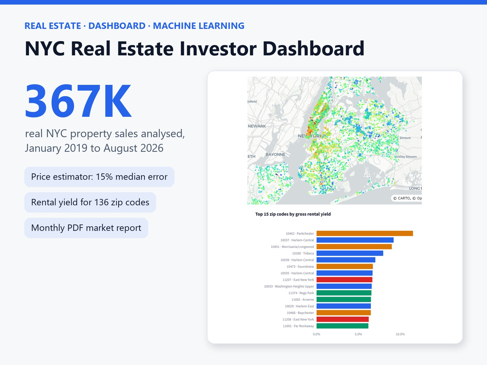
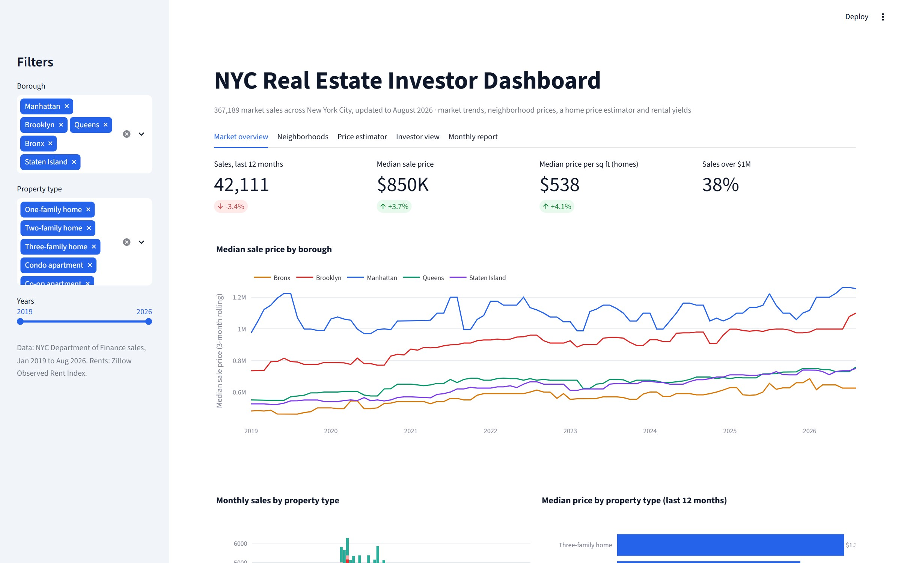
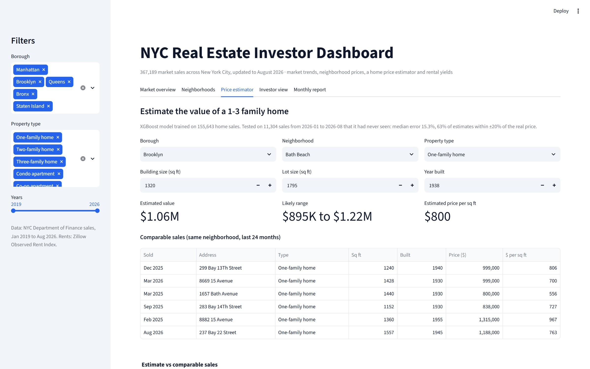
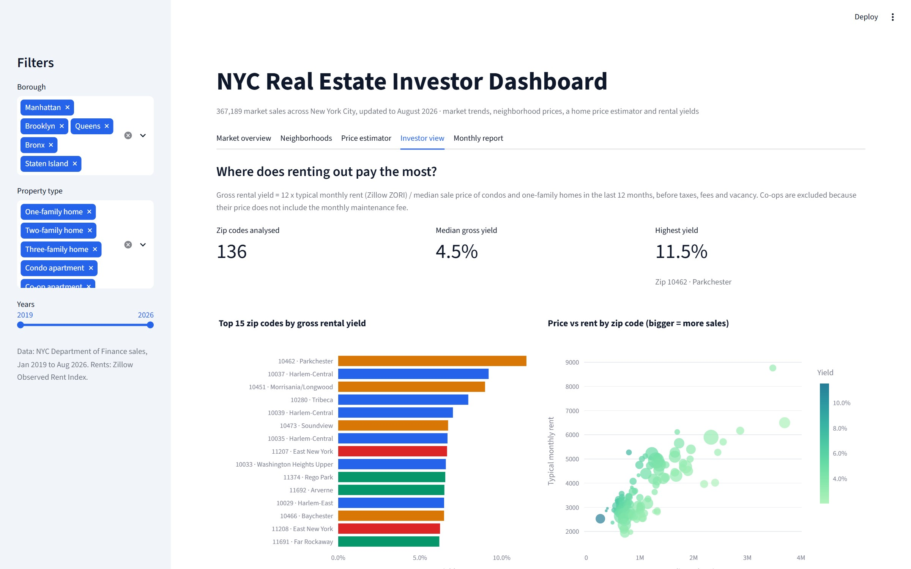

# NYC Real Estate Investor Dashboard

An interactive dashboard for real estate investors built on **367,189 real New York City property sales (January 2019 to August 2026)** and Zillow rent data. It shows market trends, neighborhood prices, a home price estimator with comparable sales, rental yields by zip code, and an automatic monthly PDF market report.



## What it does

| Tab | What you get |
|---|---|
| **Market overview** | Sales volume, median price and price per sq ft with year-over-year change; price trends by borough |
| **Neighborhoods** | Fastest-rising neighborhoods (like-for-like), a sortable table of every neighborhood, and a map of recent sales |
| **Price estimator** | Estimated value of any 1-3 family home, a likely price range, and the 6 most comparable recent sales |
| **Investor view** | Gross rental yield for 136 zip codes, price vs rent, and the rent trend for any zip |
| **Monthly report** | A 2-page PDF market report generated automatically from the same data |





## Results

**Home price estimator (XGBoost)** trained on 155,643 sales of 1-3 family homes from 2019 to 2025 and tested on **11,304 sales from 2026 that it had never seen**:

| Metric | Model | Simple baseline (neighborhood $/sq ft x size) |
|---|---|---|
| Median error | **15.3%** | 22.7% |
| Estimates within ±20% | **63%** | - |

## Method notes

- **Market sales only**: transfers under $50,000 and multi-property portfolio deeds are removed; extreme prices are trimmed per property type.
- **Like-for-like price change**: prices are compared within the same property type (houses with houses, condos with condos), so a change in what was sold does not look like growth.
- **Gross rental yield** = 12 x typical monthly rent (Zillow ZORI) / median sale price of condos and one-family homes in the last 12 months. Co-ops are excluded because their price does not include the monthly maintenance fee.
- **Honest model testing**: time-based split, trained on the past and tested on the future.

## Data sources (all public)

- NYC Department of Finance, Annualized and Rolling Sales (NYC Open Data)
- Zillow Observed Rent Index (ZORI) by zip code
- US Census ZCTA gazetteer (zip code centres)

## Run it

```bash
python -m venv .venv
.venv\Scripts\activate        # Windows  (macOS/Linux: source .venv/bin/activate)
pip install -r requirements.txt

cd src
python fetch_data.py      # download the latest public data
python clean.py           # clean and build analysis tables
python train_model.py     # train and test the price estimator
python report.py          # create the monthly PDF report
cd ..
streamlit run app.py
```

## Project structure

```
app.py               Streamlit dashboard
src/fetch_data.py    downloads NYC sales, Zillow rents, zip centres
src/clean.py         cleaning rules, property types, rental yield
src/train_model.py   XGBoost price estimator + time-based evaluation
src/report.py        monthly PDF market report
src/common.py        shared paths, lookups, like-for-like price change
data/processed/      cleaned tables used by the app
models/              trained model + test metrics
reports/             generated PDF reports
```

Built by **Tadrous William**, data scientist.
